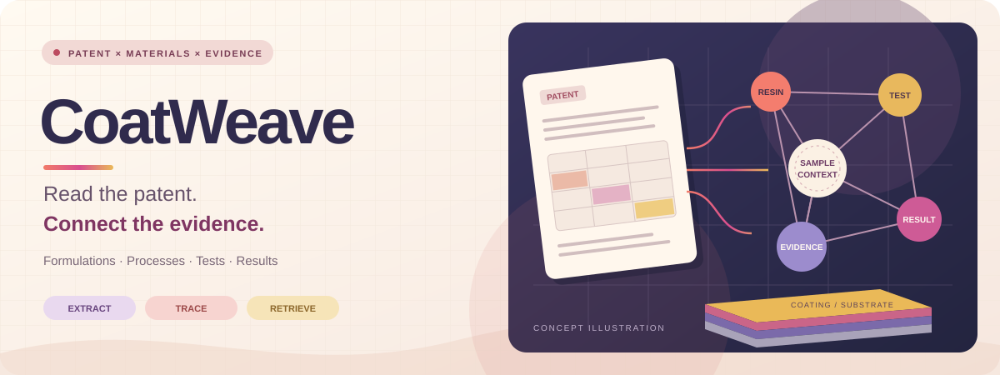
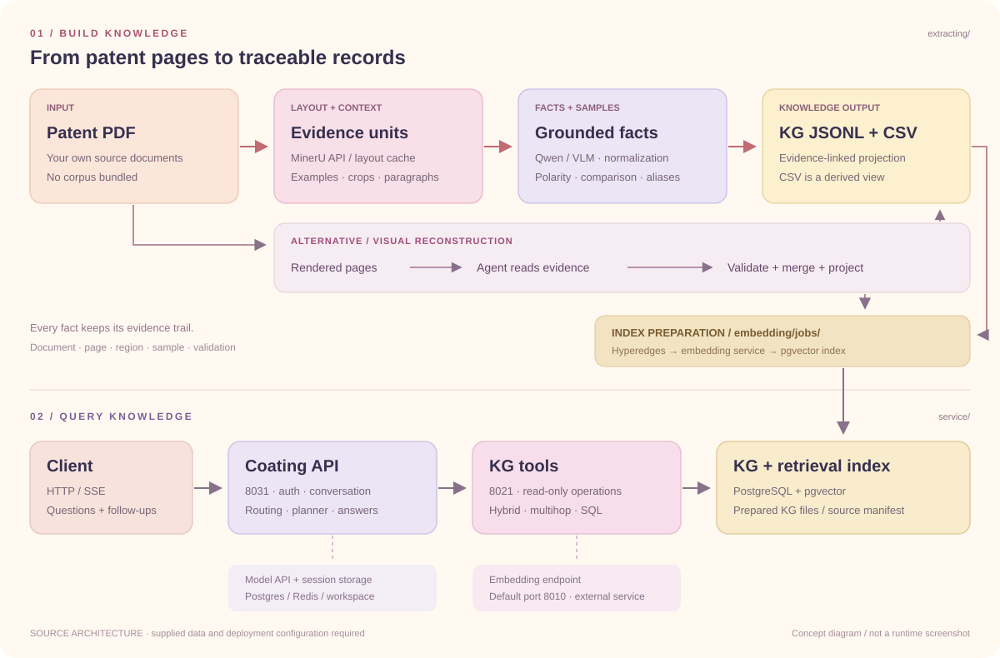

<p align="center">
  
</p>

# CoatWeave · 涂料专利知识编织

**把散落在专利图表中的材料、配方、工艺和性能，连接成可以检索、对比、追溯的证据。**

CoatWeave 面向涂料与材料配方研究，包含专利知识提取、知识图谱导出、超边索引和检索问答服务。知识图谱（KG）用节点和连接组织材料、测试与证据之间的关系。本仓库保留这些模块的**源码快照**，方便理解实现与继续开发。

*封面为项目概念插画：左侧是专利图表，中间是配方层次，右侧是连接材料、测试与结果的知识节点。*

[项目用途](#项目用途) · [工作流程](#工作流程) · [模块导航](#模块导航) · [提取入门](#提取入门) · [服务入门](#服务入门) · [项目边界](#项目边界)

## 项目用途

研究者问“某种涂料使用什么树脂、经过什么处理、在什么条件下得到什么结果”时，答案往往分散在不同页的配方表、测试表和脚注中。CoatWeave 的用途是把这些信息按照**同一专利、同一样品、同一测试上下文**组织起来，并保留回到原始证据的位置。

例如，研究“防腐涂料的配方与盐雾测试”时，可以沿着“专利 → 实施例/对比例 → 材料与工艺 → 测试条件 → 结果 → 页码和表格位置”逐层检查。这里描述的是数据组织方式，实际可回答的范围取决于你导入和校验的数据。

| 能力 | 在研究中有什么用 | 实现位置 |
| --- | --- | --- |
| 图表与上下文提取 | 把 Examples 章节中的表格、图像、说明段落放在一起理解 | [`extracting/src/coating_kg/pipeline/`](extracting/src/coating_kg/pipeline/) |
| 样品级事实与证据指针 | 区分配方、测试方法、性能结果，保留文档、页、区域与行列等定位信息 | [`db/models.py`](extracting/src/coating_kg/db/models.py) |
| 视觉重建与校验 | 由视觉代理阅读原始页面，脚本负责准备、保存、校验和投影 | [`vision_kg/`](extracting/scripts/vision_kg/) |
| 超边检索与问答 | 结合向量/词项检索、多跳证据展开和模板 SQL 聚合，组织回答 | [`service/`](service/) 与 [`embedding/`](embedding/) |

## 工作流程



*图 1 · 上半部生产知识数据，下半部消费已准备的数据。两条提取路径各自形成证据与知识记录；索引构建是独立步骤，API 不会自动把新 PDF 变成可检索数据。图中的端口对应仓库默认部署约定，实际地址由配置决定。*

1. **准备专利**：自行提供 PDF；常规提取路径调用 MinerU 在线接口，或读取已有版面缓存。
2. **建立证据**：定位 Examples、切出图表，结合视觉描述与匹配段落抽取事实，再处理样品上下文、正例/对比例及实体规范化。
3. **形成知识数据**：保存逐单元审计文件，导出 KG JSONL（每行一条 JSON 记录）；宽表 CSV 从知识图谱投影生成。另一条视觉重建路径由代理直接阅读渲染页面并生成知识包。
4. **准备检索索引**：`embedding/jobs/` 将答案超边组织成检索对象，调用嵌入服务并写入 PostgreSQL/pgvector；集合清单用于约束导入范围。
5. **提供检索问答**：FastAPI 编排会话、问题路由和模型调用；独立 KG tools 负责混合检索、证据展开与聚合查询。

这里的**超边**可以理解为“一张连接多项信息的卡片”：它把同一样品的材料、工艺、基材、测试、结果和证据放在一起。`facts.json` 等原始抽取文件用于审计，规范化事实与 KG 投影用于下游使用；CSV 是派生视图。详见[字段契约](extracting/docs/KG_FIELD_CONTRACT.md)和[视觉重建契约](extracting/docs/AGENT_NATIVE_VISION_KG_RECONSTRUCTION.md)。字段契约包含目标版本设计，新增字段仍需对应的模型和导出迁移。

## 模块导航

| 路径 | 职责 | 建议入口 |
| --- | --- | --- |
| [`extracting/`](extracting/) | 独立 Python 提取包，含 CLI、提示词、数据库结构与测试 | [`cli.py`](extracting/src/coating_kg/cli.py)、[`run_pipeline.py`](extracting/scripts/run_pipeline.py) |
| [`extracting/scripts/vision_kg/`](extracting/scripts/vision_kg/) | 视觉重建的批次管理、知识包校验、合并与 CSV 投影 | [`agent_native_batch.py`](extracting/scripts/vision_kg/agent_native_batch.py)、[`validate_vision_pack.py`](extracting/scripts/vision_kg/validate_vision_pack.py) |
| [`embedding/jobs/`](embedding/jobs/) | 服务器侧超边索引、集合级增量导入与检索评估工具 | [`server_hyperedge_pgvector_job.py`](embedding/jobs/server_hyperedge_pgvector_job.py) |
| [`service/api/`](service/api/) | HTTP 接口、鉴权、会话工作区与回答编排 | [`main.py`](service/api/main.py)、[`app.py`](service/api/app.py) |
| [`service/core/`](service/core/) | 问题分类、工具路由、证据包、会话记忆与回答组织 | [`query_classification.py`](service/core/query_classification.py)、[`routing.py`](service/core/routing.py) |
| [`service/kg_tools/`](service/kg_tools/) | 只读知识工具服务 | [`kg_expand_http_service.py`](service/kg_tools/kg_expand_http_service.py) |
| [`service/pi-harness/`](service/pi-harness/) | 独立 Pi SDK 会话与 HTTP/SSE；默认 Milvus，可显式选择调用既有 KG 工具 | [`Pi 服务说明`](service/pi-harness/README.md) |
| [`service/storage/`](service/storage/) | 服务侧会话状态与持久化 | [`repository.py`](service/storage/repository.py) |
| [`service/systemd/`](service/systemd/) | A100 部署服务单元 | [`service/README.md`](service/README.md) |

## 提取入门

以下命令从仓库根目录开始，采用 macOS/Linux shell。提取包要求 **Python 3.10+**；Windows 可在相应虚拟环境中使用同一 Python 命令。

### 1. 安装独立提取环境

```bash
cd extracting
python3 -m venv .venv
source .venv/bin/activate
python -m pip install -e ".[dev]"
cp .env.example .env
```

先只验证章节识别、正例/对比例和比较组等确定性逻辑，可以运行以下测试；这组测试无需数据库或在线 API：

```bash
python -m pytest tests/test_section_split.py tests/test_polarity.py tests/test_comparison_group.py -v
```

### 2. 配置模型与输入 PDF

编辑 `extracting/.env`，按实际供应商与部署填写。当前入口以[配置代码](extracting/src/coating_kg/config.py)为准：

| 配置项 | 用途 |
| --- | --- |
| `MINERU_TOKEN`、`MINERU_API_BASE` | 在线 PDF 版面解析；已有缓存时可复用版面结果 |
| `OPENAI_API_KEY`、`OPENAI_BASE_URL` | 视觉/文本模型的兼容接口凭据与地址 |
| `QWEN_VL_MODEL`、`QWEN_TEXT_MODEL`、`QWEN_TABLE_OCR_MODEL` | 配置各阶段使用的模型名称 |
| `PDF_INPUT_DIR`、`MINERU_OUTPUT_DIR` | PDF 输入与版面缓存路径 |
| `DB_HOST`、`DB_PORT`、`DB_NAME`、`DB_USER`、`DB_PASSWORD` | 需要直接写数据库时使用 |

当前 `Settings` 读取 `OPENAI_API_KEY`。缺少 MinerU 凭据且没有缓存时，解析函数会返回占位结果，不能把它当成完成了真实提取。

### 3. 从一篇 PDF 开始

仍在 `extracting/` 中，将示例路径替换成你自己的 PDF：

```bash
python scripts/run_pipeline.py /absolute/path/your-patent.pdf --with-kg
```

这个批处理入口通过 `ingest --skip-db` 提取文件，随后构建 KG 与 CSV。默认输出包括 `data/units/` 下的单元文件、`data/kg/` 下的 JSONL 和 `output/coatings_wide.csv`；这些运行产物未随源码附带。需要逐步检查抽取时，也可只运行：

```bash
python -m coating_kg ingest /absolute/path/your-patent.pdf --skip-db
```

`--skip-db` 跳过数据库写入，仍会调用已配置的在线解析与模型服务。直接执行 `ingest` 不会自动完成后续 KG/CSV 导出。

### 4. 需要直接写 PostgreSQL 时

[`docker-compose.yml`](extracting/docker-compose.yml) 提供 PostgreSQL 16 + pgvector。先填写 `.env` 中数据库配置，并在主机安装 PostgreSQL 客户端工具 `psql` 和 `pg_isready`，再执行：

```bash
docker compose up -d
bash scripts/setup_db.sh
python -m coating_kg ingest /absolute/path/your-patent.pdf
```

`setup_db.sh` 应用结构和种子数据；提取数据库与服务侧会话数据库/检索索引的准备是不同步骤。视觉重建另见[工作流契约](extracting/docs/AGENT_NATIVE_VISION_KG_RECONSTRUCTION.md)，其中脚本只管理素材和校验，专利语义由视觉代理判断。

## 服务入门

`service/` 有自己的依赖，需单独安装。它面向**已经准备好的 KG 数据、检索索引和嵌入服务**，包含两个协作进程：

| 进程 | 默认部署端口 | 责任 |
| --- | --- | --- |
| Coating API | `8031` | 鉴权、会话、规划、模型回答、普通与流式接口 |
| KG tools | `8021` | 混合检索、多跳证据展开、模板聚合、词表和文档字段查询 |

### 1. 单独安装并配置

在新终端中，从仓库根目录开始：

```bash
cd service
python3 -m venv .venv
source .venv/bin/activate
python -m pip install -r requirements.txt
python -m pip install psycopg2-binary
cp config/.env.example .env
```

服务依赖表提供会话存储所用的 `psycopg`；KG tools 的检索连接仍导入 `psycopg2`，因此独立安装时需补装上面的驱动，见[`pg_connect`](service/kg_tools/expand_hyperedge_multihop.py)。

按[`api/config.py`](service/api/config.py)配置 `COATING_SERVICE_ROOT`、`COATING_DATA_ROOT`、`COATING_API_TOKEN`、`COATING_POSTGRES_DSN`、`COATING_REDIS_URL` 与模型地址、模型名称、凭据。`COATING_SERVICE_ROOT` 应指向当前服务的绝对路径；仓库中的默认路径和 systemd 单元沿用 A100 部署目录。

还需准备 KG tools 的数据与检索配置，如 `KG_SOURCE_MANIFEST` 或 `KG_AGGREGATE_DIR`、`KG_HYBRID_CONFIG` 和 `KG_HYBRID_EMBED_URL`。KG tools 当前从代码中的 `DEFAULT_PG_ENV` 位置读取检索库连接配置，默认在 `/root/coating/embedding/pgvector.env`；这是独立部署前提，不能用 API 的会话 DSN 代替。相关默认路径见[`expand_hyperedge_multihop.py`](service/kg_tools/expand_hyperedge_multihop.py)。

### 2. 初始化并启动两个进程

在 `service/` 的虚拟环境中，准备好上述外部依赖后：

```bash
python scripts/init_db.py
```

终端 A：将你已填写的 `.env` 导出给独立工具进程，再启动它。下面的加载方式要求 `.env` 使用 shell 可解析的赋值语法。

```bash
source .venv/bin/activate
set -a
source .env
set +a
KG_EXPAND_HOST=127.0.0.1 KG_EXPAND_PORT=8021 python kg_tools/kg_expand_http_service.py
```

终端 B：同样进入 `service/`，启动 API。API 配置类会读取本目录的 `.env`。

```bash
source .venv/bin/activate
python -m uvicorn api.main:app --host 127.0.0.1 --port 8031
```

需要常驻 A100 部署时，参考[服务部署说明](service/README.md)，先按实际机器修改 systemd 的 `WorkingDirectory`、`EnvironmentFile` 与 `ExecStart` 路径。

### 3. 发送最小请求

在调用方终端中设置 `COATING_API_TOKEN` 为服务配置的令牌，再调用：

```bash
curl http://127.0.0.1:8031/api/v1/coating/chat \
  -H "Authorization: Bearer $COATING_API_TOKEN" \
  -H "Content-Type: application/json" \
  -d '{"conversation_id":"research-1","user_id":"researcher-1","question":"船舶防腐蚀配方有多少？举几个例子","options":{"include_debug":false}}'
```

普通问答入口为 `POST /api/v1/coating/chat`；流式入口包括 `POST /api/v1/coating/chat/stream` 和平台兼容的 `POST /api/ask/stream/chat/completions`。兼容流采用 SSE，即服务持续发送事件，最终以 `[DONE]` 结束。请求、鉴权和通用部署步骤见[服务 README](service/README.md)。

健康检查入口为 `/health`，依赖就绪检查为 `/ready`。仓库也提供[服务 smoke 脚本](service/scripts/smoke_test.py)，应在依赖齐备且服务启动后执行。

## 项目边界

| 项目 | 主要用途 | 关系 |
| --- | --- | --- |
| **CoatWeave（本仓库）** | 从专利证据构建 KG、准备超边检索对象，再通过 API 组织检索问答 | 包含提取、索引作业与独立服务模块 |
| **[Pi Harness 服务](service/pi-harness/README.md)** | Pi SDK 会话与工具循环；可选 Milvus 或既有 KG HTTP 工具 | 与 Python KG API 分别启动；KG 适配复用原服务逻辑，不代表自动部署或生产验收 |
| **[coat_weave_harness](https://github.com/Nathan10969/coat_weave_harness)** | 独立的专利检索与全文查证：按章节切片、嵌入召回、重排，再用工具阅读全文并给出行号引用 | 其 `main` 分支不调用或依赖本仓库的 `service/`，也不是本仓库的服务启动入口 |

本快照未附带原始 PDF、ZIP 数据包、提取语料、JSONL 数据集、数据库内容、向量索引、运行状态、日志、缓存、虚拟环境、备份或含密钥的 `.env` 文件。模型服务、部署端点、凭据和数据路径需要自行准备。

详细提取流程见[提取包说明](extracting/README.md)，无需数据库或在线 API 的练习见[离线示例](extracting/SAMPLE_RUN.md)。记录格式见[字段契约](extracting/docs/KG_FIELD_CONTRACT.md)；配置与可用字段以相应源码为准。
